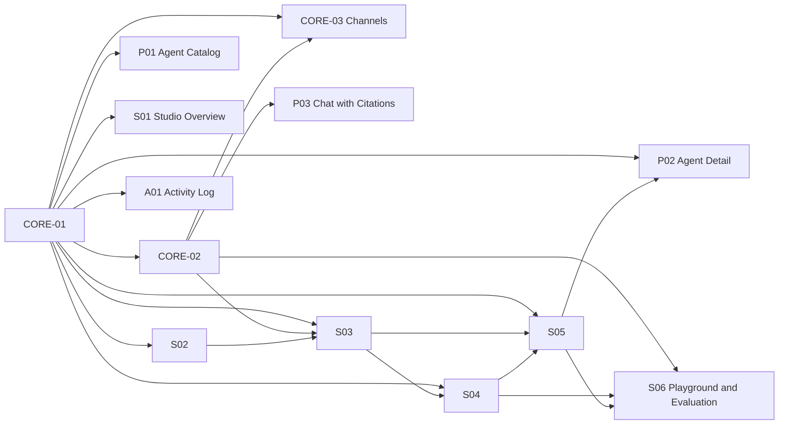

# Specs ของ Studio (แยกตามหน้า)

1 หน้า = 1 branch = 1 spec = 1 เจ้าของ แต่ละหน้าทำทั้ง UI, API และ lib ของตัวเองครบในโฟลเดอร์ที่เป็นเจ้าของ (ดูข้อ 8 ของแต่ละ spec และ `.github/CODEOWNERS`)
งานกลาง (`core/*`) ไม่ใช่หน้าจอ แต่ทุกหน้าต้องใช้ จึงต้อง merge เข้า `staging` ก่อน

- Data model กลาง: [00-data-model.md](00-data-model.md) • Type กลาง: `lib/studio/types.ts`
- แม่แบบ Spec / Handoff: [_TEMPLATE.md](_TEMPLATE.md), [../handoff/_TEMPLATE.md](../handoff/_TEMPLATE.md)
- Board: Miro "NeuronKnowledge Studio"

| ID | หน้า | บทบาท | Route | Branch | ต้องรอ | กำหนด |
|---|---|---|---|---|---|---|
| CORE-01 | [Foundation](CORE-01-foundation.md) | ทุกบทบาท (งานกลาง) | - | `core/foundation` | - | สัปดาห์ 1 |
| CORE-02 | [Knowledge Engine](CORE-02-engine.md) | ทุกบทบาท (งานกลาง) | - | `core/engine` | CORE-01 | สัปดาห์ 1–3 |
| CORE-03 | [Channels](CORE-03-channels.md) | ทุกบทบาท (งานกลาง) | - | `core/channels` | CORE-01, CORE-02 | สัปดาห์ 3–5 (LINE) / หลัง Expo |
| P01 | [Agent Catalog](P01-agent-catalog.md) | User | `/agents` | `page/agent-catalog` | CORE-01 | สัปดาห์ 2–3 |
| P02 | [Agent Detail](P02-agent-detail.md) | User | `/agents/[slug]` | `page/agent-detail` | CORE-01, S05 | สัปดาห์ 2–4 |
| P03 | [Chat with Citations](P03-chat-citations.md) | User | `/chat` `/chat/[id]` | `page/chat-citations` | CORE-02 | สัปดาห์ 3–4 |
| S01 | [Studio Overview](S01-studio-overview.md) | Creator | `/studio` | `page/studio-overview` | CORE-01 | สัปดาห์ 3–4 |
| S02 | [Data Connections](S02-studio-connections.md) | Creator | `/studio/connections` | `page/studio-connections` | CORE-01 | สัปดาห์ 1–2 |
| S03 | [Knowledge Sets](S03-studio-knowledge-sets.md) | Creator | `/studio/knowledge` `/studio/knowledge/new` `/studio/knowledge/[id]` | `page/studio-knowledge-sets` | CORE-01, CORE-02, S02 | สัปดาห์ 2–3 |
| S04 | [Use Cases](S04-studio-use-cases.md) | Creator | `/studio/knowledge/[id]/use-cases` | `page/studio-use-cases` | CORE-01, S03 | สัปดาห์ 2–3 |
| S05 | [Agent Builder](S05-studio-agent-builder.md) | Creator | `/studio/agents` `/studio/agents/[id]` | `page/studio-agent-builder` | CORE-01, S03, S04 | สัปดาห์ 3–4 |
| S06 | [Playground and Evaluation](S06-studio-playground.md) | Creator | `/studio/agents/[id]/test` | `page/studio-playground` | CORE-02, S04, S05 | สัปดาห์ 4 |
| A01 | [Activity Log](A01-admin-activity.md) | Admin | `/admin/activity` | `page/admin-activity` | CORE-01 | สัปดาห์ 2–4 |

## ลำดับการ merge เข้า staging

1. `core/foundation` (CORE-01) — ต้องเข้าก่อน ทุกหน้าใช้ role, migration, `logActivity()`
2. `core/engine` (CORE-02) เป็นชุดแรกที่ใช้ได้ (index ไฟล์ + ค้นหา) — หน้าที่รอใช้ข้อมูลจำลองตาม type ใน `lib/studio/types.ts` ไปก่อน
3. หน้าที่ไม่รอใคร: S02, P01, A01, S01 → ตามด้วย S03 → S04 → S05 → S06, P02, P03
4. `core/channels` (CORE-03): LINE ให้ทันเดโม ที่เหลือหลัง Expo

## ความสัมพันธ์

