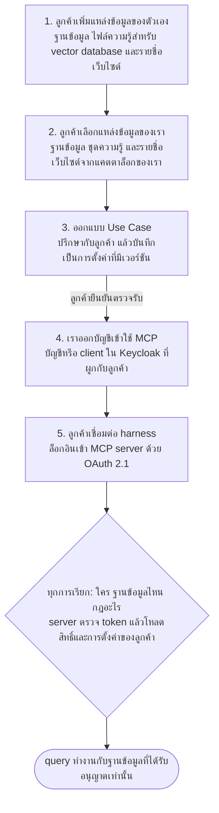

# MCP Hub: ขั้นตอนการทำงานตั้งแต่ตั้งค่าฐานข้อมูลจนเชื่อมต่อ AI

ภาพรวมว่าลูกค้าเริ่มจากส่งข้อมูลฐานข้อมูลให้เรา ไปจนถึงเชื่อมต่อ AI harness ของตัวเองกับ MCP server กลางของเราได้อย่างไร และ server ทำอะไรในทุกครั้งที่ถูกเรียกใช้

## สารบัญ

- [ภาพรวม](#ภาพรวม)
- [ระยะที่ 1: ลูกค้าเพิ่มแหล่งข้อมูลของตัวเอง](#ระยะที่-1-ลูกค้าเพิ่มแหล่งข้อมูลของตัวเอง)
- [ระยะที่ 2: ลูกค้าเลือกแหล่งข้อมูลของเรา](#ระยะที่-2-ลูกค้าเลือกแหล่งข้อมูลของเรา)
- [ระยะที่ 3: ออกแบบ Use Case](#ระยะที่-3-ออกแบบ-use-case)
- [ระยะที่ 4: ออกบัญชีเข้าใช้ MCP](#ระยะที่-4-ออกบัญชีเข้าใช้-mcp)
- [ระยะที่ 5: ลูกค้าเชื่อมต่อ harness](#ระยะที่-5-ลูกค้าเชื่อมต่อ-harness)
- [สิ่งที่เกิดขึ้นในทุกครั้งที่เรียกใช้](#สิ่งที่เกิดขึ้นในทุกครั้งที่เรียกใช้)
- [ข้อมูลที่เราต้องเก็บ](#ข้อมูลที่เราต้องเก็บ)
- [กฎที่ server ต้องบังคับใช้](#กฎที่-server-ต้องบังคับใช้)
- [เรื่องที่ต้องตัดสินใจ](#เรื่องที่ต้องตัดสินใจ)

## ภาพรวม

MCP server เป็นตัวกลางที่ลูกค้าทุกรายใช้ร่วมกัน สิ่งที่ต่างกันในแต่ละลูกค้าคือ token ที่ส่งมา และสิทธิ์กับการตั้งค่าที่ server ค้นหาจาก token นั้น

## ระยะที่ 1: ลูกค้าเพิ่มแหล่งข้อมูลของตัวเอง

ลูกค้านำแหล่งข้อมูลมาได้ 3 แบบ และ AI เข้าถึงแต่ละแบบผ่านเครื่องมือ MCP ของตัวเอง

| แหล่งข้อมูล | สิ่งที่ลูกค้าให้เรา | เครื่องมือ MCP |
| --- | --- | --- |
| ฐานข้อมูล | การเชื่อมต่อกับฐานข้อมูลของลูกค้าเอง พร้อมคำอธิบายข้อมูล | `database_query`, `database_catalog` |
| ไฟล์ความรู้ (vector database) | เอกสารที่ลูกค้าอัปโหลด ซึ่งเราแบ่งเป็นส่วนย่อยแล้วทำ embedding เก็บใน vector database ของเรา | `rag_query` |
| เว็บไซต์ | รายชื่อเว็บไซต์ที่ลูกค้าสนใจ | `web_search` |

1. **ลูกค้าล็อกอินเข้าเว็บพอร์ทัล** ลูกค้าจัดการแหล่งข้อมูลและ use case ของตัวเองที่นี่
2. **เพิ่มการเชื่อมต่อฐานข้อมูล** ระบุชนิดฐานข้อมูล (MySQL, SQL Server, PostgreSQL ฯลฯ), host, port, ชื่อฐานข้อมูล และบัญชีแบบอ่านอย่างเดียวที่ลูกค้าสร้างเอง
3. **ทำให้ server ของเราเข้าถึงฐานข้อมูลได้** ถ้าจำเป็น ลูกค้าอนุญาต IP ของ server เรา หรือตั้งค่า VPN
4. **ทดสอบการเชื่อมต่อ** พอร์ทัลตรวจว่าล็อกอินและอ่าน schema ได้ และแสดงข้อผิดพลาดถ้ามี
5. **อธิบายข้อมูล** คำอธิบายระดับฐานข้อมูล ตาราง และคอลัมน์ พร้อมอภิธานศัพท์ทางธุรกิจ คำแนะนำการ join และข้อมูลอื่นที่ช่วยให้ AI เข้าใจข้อมูล
6. **อัปโหลดไฟล์ความรู้** ลูกค้าอัปโหลดเอกสาร (เช่น PDF, Word หรือไฟล์ข้อความ) และตั้งชื่อคอลเลกชันพร้อมคำอธิบายสั้น ๆ ว่ามีเนื้อหาเกี่ยวกับอะไร
7. **เรา embed ไฟล์เข้า vector database** ไฟล์ถูกแบ่งเป็นส่วนย่อย ทำ embedding และเก็บในคอลเลกชันที่เป็นของลูกค้ารายนั้นเท่านั้น พอร์ทัลแสดงสถานะการประมวลผลและไฟล์ที่ล้มเหลว
8. **เพิ่มรายชื่อเว็บไซต์** ลูกค้าระบุเว็บไซต์ที่ต้องการให้ AI ใช้ พร้อมโน้ตสั้น ๆ ว่าแต่ละแห่งใช้ทำอะไร เราตรวจว่าแต่ละที่อยู่เข้าถึงได้

> **คำเตือน: รหัสผ่านและไฟล์ของลูกค้าเป็นข้อมูลอ่อนไหว** รหัสผ่านฐานข้อมูลต้องเข้ารหัสก่อนเก็บ ไม่แสดงอีกหลังบันทึก และไม่เขียนลง log ส่วนไฟล์ที่อัปโหลดและ embedding แยกเก็บตามลูกค้า และลูกค้าลบเองได้

## ระยะที่ 2: ลูกค้าเลือกแหล่งข้อมูลของเรา

1. **ดูแคตตาล็อกของเรา** แคตตาล็อกมี 3 ชนิด ได้แก่ ฐานข้อมูลของเรา ชุดความรู้ใน vector database ของเรา และรายชื่อเว็บไซต์ของเรา แต่ละรายการมีคำอธิบายเนื้อหา และสำหรับฐานข้อมูลมีคำอธิบายโครงสร้างด้วย
2. **เลือกแหล่งข้อมูลหนึ่งรายการขึ้นไป** เลือกผสมกันได้ทั้งฐานข้อมูล ชุดความรู้ และรายชื่อเว็บไซต์ ตามความต้องการหรือความสนใจ
3. **บันทึกการเลือก** ตารางความสัมพันธ์เชื่อมลูกค้ากับแหล่งข้อมูลที่เลือกแต่ละรายการ ทั้งของเราและของลูกค้าเอง เพื่อให้ server รู้ชัดว่าลูกค้ารายนั้นใช้ฐานข้อมูล คอลเลกชันความรู้ และเว็บไซต์ใดได้บ้าง

## ระยะที่ 3: ออกแบบ Use Case

1. **ปรึกษากับลูกค้า** เรียนรู้ว่าลูกค้าต้องการอะไรจากข้อมูลที่เลือก คำถามที่ถามบ่อย ใครเป็นคนถาม และอะไรที่ต้องซ่อน
2. **เราออกแบบชุดการตั้งค่า** system prompt (พร้อมอภิธานศัพท์และคำแนะนำการ join), รายการคำถามแนะนำ, ขอบเขตข้อมูล (ตารางและคอลัมน์ที่ใช้ได้), การตั้งค่าเครื่องมือ (จำนวนแถว, timeout, การ export) และชุดทดสอบที่มีคำถามกับคำตอบที่คาดหวัง
3. **ทดสอบด้วยคำถามของลูกค้า** รันชุดทดสอบกับระบบจริง แล้วแก้คำตอบที่ผิด
4. **ลูกค้ายืนยันตรวจรับ** บันทึกเป็นเวอร์ชัน 1 และผูกกับลูกค้า การแก้ไขภายหลังจะเป็นเวอร์ชัน 2, 3 ต่อไป ย้อนกลับได้

## ระยะที่ 4: ออกบัญชีเข้าใช้ MCP

1. **สร้างตัวตนใน Keycloak** บัญชีผู้ใช้สำหรับคนที่ล็อกอินเอง หรือ client ID และ secret สำหรับ harness อัตโนมัติของลูกค้า
2. **ผูกตัวตนกับลูกค้า** ฐานข้อมูลของเราบันทึกว่าผู้ใช้หรือ client ใน Keycloak แต่ละรายเป็นของลูกค้ารายใด
3. **ส่งมอบข้อมูลเข้าใช้** ลูกค้าได้รับ URL ของ MCP server และข้อมูลล็อกอินหรือ client secret ผ่านช่องทางที่ปลอดภัย พร้อมคู่มือตั้งค่า harness

## ระยะที่ 5: ลูกค้าเชื่อมต่อ harness

| ตัวเลือก | วิธีทำงาน | เหมาะกับ |
| --- | --- | --- |
| ล็อกอินแบบผู้ใช้ | harness เปิดหน้าล็อกอินของ Keycloak คนกดอนุมัติ แล้ว harness ได้ token ของคนนั้น | เครื่องมือที่คนใช้งานโดยตรง |
| ข้อมูลเข้าใช้แบบเครื่อง (machine credential) | harness ใช้ client ID และ secret ขอ token เองได้โดยไม่ต้องมีคน | agent อัตโนมัติและงานที่ตั้งเวลา |

1. ลูกค้าใส่ URL ของ MCP server ใน harness
2. harness ขอ access token จาก Keycloak ด้วย OAuth 2.1
3. harness เรียก MCP server โดยส่ง token ใน `Authorization: Bearer <token>`
4. server รับคำขอเฉพาะเมื่อ token ถูกต้อง ดังนั้นรายการเครื่องมือชุดแรกก็สะท้อนสิทธิ์ของลูกค้านั้นแล้ว

## สิ่งที่เกิดขึ้นในทุกครั้งที่เรียกใช้

1. **ตรวจ token** ตรวจลายเซ็น วันหมดอายุ และ audience กับ Keycloak
2. **ระบุลูกค้า** จับคู่ผู้ใช้หรือ client ใน token กับข้อมูลลูกค้า
3. **โหลดสิทธิ์และการตั้งค่า** แหล่งข้อมูลที่ใช้ได้ (ฐานข้อมูล คอลเลกชันความรู้ และรายชื่อเว็บไซต์) และเวอร์ชัน use case ที่อนุมัติล่าสุด
4. **ตรวจคำขอ** ฐานข้อมูล ตาราง คอลัมน์ คอลเลกชันความรู้ หรือเว็บไซต์ที่ขอ ต้องอยู่ในขอบเขตข้อมูล ถ้าไม่ใช่ให้ปฏิเสธ
5. **เลือก connector ที่ถูกต้อง** ชนิดของฐานข้อมูลกำหนดว่าจะใช้ adapter ตัวไหนรัน query
6. **รันอย่างปลอดภัย** ใช้บัญชีอ่านอย่างเดียว อนุญาตเฉพาะคำสั่งอ่าน กำหนดจำนวนแถวสูงสุดและ timeout
7. **ส่งผลลัพธ์และบันทึก log** audit log บันทึกว่าใครถามอะไร กับฐานข้อมูลไหน เมื่อไร

## ข้อมูลที่เราต้องเก็บ

| รายการ | วัตถุประสงค์ |
| --- | --- |
| ลูกค้า | องค์กรและผู้ใช้หรือ client ID ของลูกค้า |
| การผูกตัวตน | จับคู่ผู้ใช้หรือ client ใน Keycloak แต่ละรายกับลูกค้า |
| การเชื่อมต่อฐานข้อมูล | ชนิด host port และข้อมูลล็อกอินแบบอ่านอย่างเดียวที่เข้ารหัส สำหรับฐานข้อมูลของลูกค้า |
| คอลเลกชันความรู้ | ชุดไฟล์ที่อัปโหลดและ embedding ใน vector database ซึ่งเป็นของลูกค้าหรือของเรา |
| รายชื่อเว็บไซต์ | เว็บไซต์ที่ลูกค้าหรือเราเลือกไว้ให้ `web_search` พร้อมโน้ตของแต่ละแห่ง |
| คำอธิบาย schema | คำอธิบายระดับฐานข้อมูล ตาราง คอลัมน์ และอภิธานศัพท์ |
| ความสัมพันธ์ลูกค้ากับแหล่งข้อมูล | ลูกค้าแต่ละรายใช้ฐานข้อมูล คอลเลกชันความรู้ และรายชื่อเว็บไซต์ใดได้บ้าง ทั้งของเราและของลูกค้า |
| การตั้งค่า Use Case | มีเวอร์ชัน: system prompt, คำถามแนะนำ, ขอบเขตข้อมูล, การตั้งค่าเครื่องมือ และชุดทดสอบ |
| Audit log | บันทึกทุกการเรียกใช้ เพื่อตรวจสอบและแก้ปัญหา |

## กฎที่ server ต้องบังคับใช้

- **การแยกลูกค้า:** ทุกการเรียกต้องถูกตรวจกับรายการฐานข้อมูล คอลเลกชันความรู้ และเว็บไซต์ที่ลูกค้าใช้ได้ ในโค้ดของ server ไม่ปล่อยให้ AI ตัดสินเอง การค้นหาใน vector database ต้องกรองตามคอลเลกชันของลูกค้ารายนั้นเสมอ
- **อ่านอย่างเดียว:** ใช้บัญชีฐานข้อมูลแบบอ่านอย่างเดียว และตรวจว่ารันได้เฉพาะคำสั่งอ่าน
- **ขีดจำกัด:** จำกัดจำนวนแถว timeout และอัตราการเรียกต่อลูกค้า
- **ความลับ:** รหัสผ่านฐานข้อมูลต้องเข้ารหัส ซ่อนหลังบันทึก และไม่อยู่ใน log
- **การเพิกถอนสิทธิ์:** ปิดสิทธิ์ลูกค้ารายหนึ่งได้โดยปิดตัวตนของเขา โดยไม่กระทบรายอื่น

## เรื่องที่ต้องตัดสินใจ

1. ตอนเปิดตัวจะให้ล็อกอินแบบผู้ใช้ ข้อมูลเข้าใช้แบบเครื่อง หรือทั้งสองแบบ
2. จะรองรับฐานข้อมูลชนิดไหนก่อน
3. ลูกค้าจะให้เราเข้าถึงฐานข้อมูลอย่างไร: อนุญาต IP, VPN หรืออย่างอื่น
4. use case เป็นแค่คำแนะนำให้ AI หรือกำหนดกฎที่ server บังคับด้วย เช่นขอบเขตตาราง (เราแนะนำแบบหลัง)
5. ใครอนุมัติการแก้ use case หลังลูกค้าตรวจรับ และจะแจ้งลูกค้าอย่างไร
6. ลูกค้าอัปโหลดไฟล์ชนิดและขนาดใดได้บ้าง และเว็บไซต์จะดึงสดทุกครั้งที่ค้นหา หรือ crawl แล้วทำดัชนีไว้ล่วงหน้า
